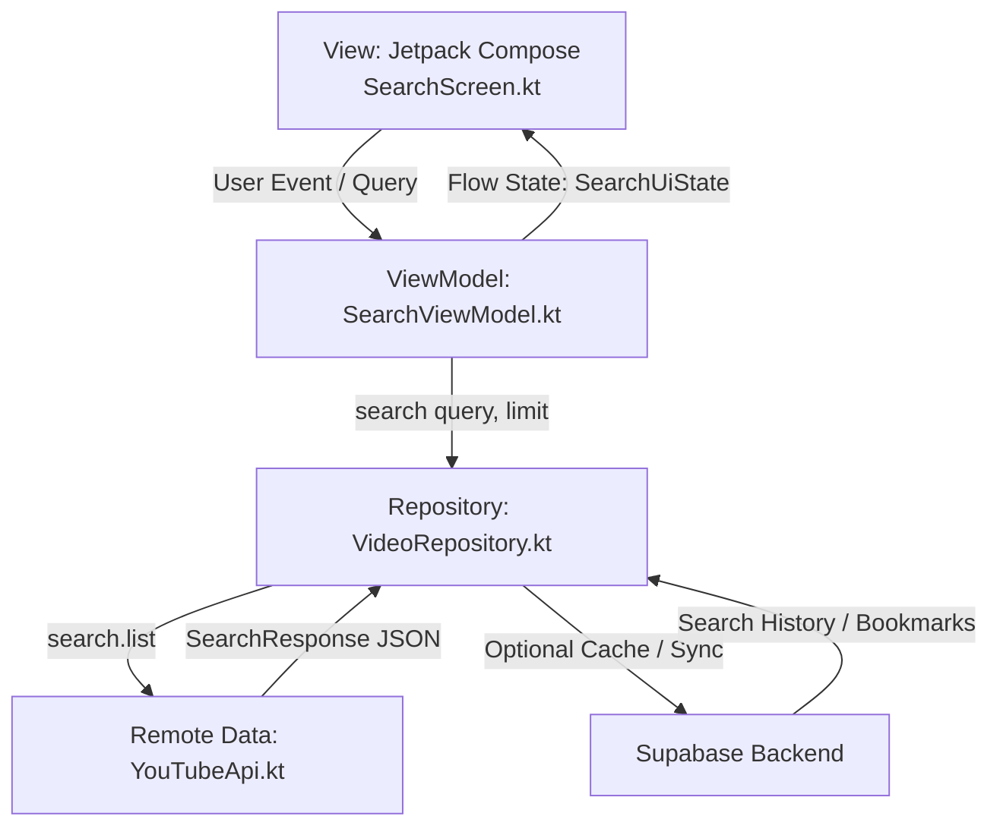

# Arsitektur Aplikasi - YT Index

Dokumen ini menjelaskan arsitektur teknis dan komponen aplikasi Android **YT Index**.

---

## 1. Ikhtisar Arsitektur

Aplikasi YT Index menggunakan pola arsitektur modern **MVVM (Model-View-ViewModel)** dengan **Unidirectional Data Flow (UDF)** yang direkomendasikan oleh Google:

---

## 2. Lapisan Aplikasi (Layers)

### A. Presentation Layer (`app/src/main/java/com/example/ytindex/ui/`)
- **`MainActivity.kt`**: Entry point activity Android, menerapkan `ComponentActivity` dan `setContent` dengan tema Material 3 adaptif (Light/Dark mode).
- **`SearchScreen.kt`**: UI deklaratif berbasis Jetpack Compose:
  - Input field kata kunci pencarian.
  - Slider responsif untuk mengatur batasan hasil (1 hingga 50).
  - Tampilan daftar hasil pencarian menggunakan `LazyColumn`.
  - Kartu video interaktif yang dapat diklik untuk meluncurkan Intent membuka video di YouTube app / browser.
- **`SearchViewModel.kt`**: Mengelola state UI menggunakan `StateFlow<SearchUiState>` dan Coroutine `viewModelScope`. Menangani validasi input, status loading, dan pemetaan error (HTTP 400, HTTP 403 quota exceeded, IOException network failure).

### B. Data Layer (`app/src/main/java/com/example/ytindex/data/`)
- **`Models.kt`**:
  - Model respons mentah dari YouTube Data API v3 (`SearchResponse`, `SearchItem`, `Snippet`, `Thumbnails`).
  - Model domain untuk UI (`VideoResult`).
- **`YouTubeApi.kt`**: Retrofit 2 interface untuk endpoint `youtube/v3/search`. Serialisasi JSON menggunakan `kotlinx.serialization`.
- **`VideoRepository.kt`**: Mengabstraksi panggilan data, memfilter hanya video yang diunggah dalam rentang 1 tahun terakhir (`publishedAfter`), mempertahankan urutan relevansi, serta melakukan decoding terhadap entitas karakter HTML pada judul dan nama channel.

---

## 3. Komponen Backend (Supabase)

- **Database**: PostgreSQL 15 dengan ekstensi UUID.
- **Tabel**:
  - `public.search_history`: Menyimpan log riwayat kata kunci dan jumlah hasil.
  - `public.bookmarked_videos`: Menyimpan video favorit yang disimpan pengguna.
- **Security**: Seluruh tabel dilindungi **Row Level Security (RLS)**. Klien Android hanya menggunakan `anon_key` (publik).
- **Edge Functions**: Deno TypeScript untuk indexing dan integrasi masa depan.
